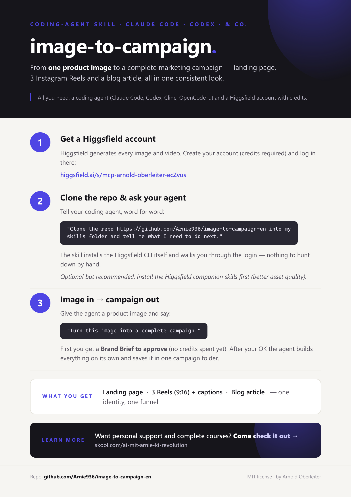

# image-to-campaign (English)

[](docs/quickstart.pdf)

> 📄 The image above is the one-page quickstart — click it for the printable
> [PDF](docs/quickstart.pdf).

A Claude Code / Claude skill that turns **one product image** into a complete,
identity-consistent marketing funnel:

- a scroll-driven **landing page**,
- **3 Instagram Reels** (9:16) with ready-to-paste captions, and
- a styled **blog article**

— all derived from a single approved **Brand Brief**, so every asset shares one
visual and verbal identity instead of looking like three unrelated AI artifacts.

> **Note:** the generated copy is **English** by default and the call-to-action is
> a demo placeholder (no real shop). Both are intentional defaults; change them
> in `SKILL.md` (the "Locked defaults" section) if you want a different language
> or a real conversion goal. Looking for German output? Use the original
> [image-to-campaign](https://github.com/Arnie936/image-to-campaign).

## How it works

```
image  →  short interview  →  Brand Brief  →  🛑 you approve  →  builds everything
```

The skill is **brief-first**: it writes one Brand Brief (product identity, thesis
line, OKLCH palette, fonts, tone, CTA, Reel angles) and shows it to you together
with every asset prompt **before spending any credits**. You approve once, then
it builds the landing page, the Reels, and the blog autonomously. The landing
page is built first so its hero video can be reused (reframed to 9:16) for one of
the Reels, saving generation cost.

## Requirements

| Requirement | Needed for | Notes |
|---|---|---|
| **Higgsfield account + credits** | All image/video generation | Sign up here: **https://higgsfield.ai/s/mcp-arnold-oberleiter-ecZvus** — an account with credits is required for any asset. |
| **Higgsfield CLI** | The generation engine | Installed automatically by the skill (`curl … install.sh \| sh`). On **Windows** the installer needs a Bash shell (e.g. Git Bash). Then run `higgsfield auth login` once. |
| **A browser + a static server** | Landing-page QA & preview | The skill runs the page locally (e.g. `python -m http.server`) and verifies it. Any static server works; Python is just the default. |
| **Internet access** | CDNs / Google Fonts / Higgsfield | The generated pages load fonts and motion libs from CDNs. |

Everything else (the orchestration logic, the landing-page spec, the Reel/blog
specs, and all templates) ships inside this skill. No extra files needed in your
project.

## Recommended companion skills

This skill drives the Higgsfield **CLI** directly, so it works on its own. For
the best asset quality it's recommended to also install the official Higgsfield
skills — they add smarter model selection and the product-photoshoot prompt
enhancer guidance:

- `higgsfield-generate`
- `higgsfield-product-photoshoot`
- `higgsfield-soul-id` (only if you want the same presenter face across all Reels)

Get them from the Higgsfield skills repo and drop them next to this skill.

## Install

Clone this repo straight into your skills directory as the skill folder:

```bash
# project-level
git clone https://github.com/Arnie936/image-to-campaign-en .agents/skills/image-to-campaign
# or user-level
git clone https://github.com/Arnie936/image-to-campaign-en ~/.claude/skills/image-to-campaign
```

Then run `higgsfield auth login` once, and you're set.

## Usage

Point the skill at an image and (optionally) a one-line idea:

> "Turn this image into a complete campaign: `./product.jpg`"

It will ask at most two questions, write the Brand Brief, stop at the checkpoint
for your approval, then build everything into a campaign folder:

```
campaign-<slug>/
  brief.md                  # the approved single source of truth
  website/
    index.html
    assets/                 # hero.mp4, middle.mp4, g1.jpg, g2.jpg, g3.jpg
  reels/
    reel-1-hook.mp4
    reel-2-showcase.mp4
    reel-3-lifestyle.mp4
    captions.md             # per reel: hook text, caption, hashtags, CTA
  blog/
    blog.html
    assets/
  README.md
```

## What's inside the skill

```
image-to-campaign/
  SKILL.md                  # orchestrator: bootstrap → interview → brief → checkpoint → build → QA → deliver
  references/
    brand-brief.md          # how the brief is derived + the full asset-prompt list
    landing-page.md         # self-contained brief-aware landing-page build + browser QA
    reels.md                # 3 Reel angles, cinematic vs UGC, reframe reuse, captions format
    blog.md                 # English SEO article spec + HTML templating
  assets/
    brief-template.md
    blog-template.html
    campaign-readme-template.md
  README.md
```

## License

MIT — see [LICENSE](LICENSE).
